<div align="center">

# Petal 🌱

**Your agents do the work. Petal keeps the receipts.**

A local task board for **Claude Code, OpenAI Codex, and OpenCode**.

See what changed, what is verified, and what still needs your attention—across projects.

**Local JSON · Git history · No account · No model API key · Free & open source**

[Get started](#install-globally) · [Take the tour](#a-little-tour) · [Connect your agents](#how-claude-code-and-codex-find-petal) · [CLI reference](#cli) · [Notifications](#notifications) · [Customize](#project-configuration-in-settings) · [Report an issue](https://github.com/luckysolanki902/petal/issues)

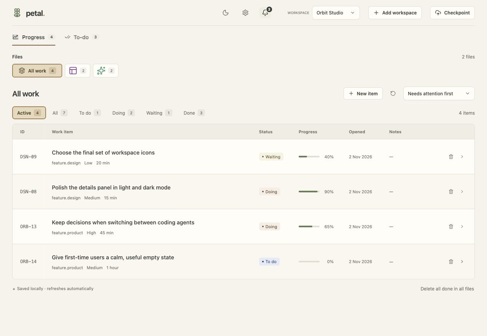

_Every screenshot below uses fictional projects and mock tasks in an isolated local installation._

</div>

## A little tour

Ever reopen an agent chat and ask, “Wait, what actually got finished?”

Petal gives that answer a home. Your agent updates structured tasks through the CLI. You get a calm dashboard with the findings, changes, verification, and next steps beside the work.

| You want to…                                       | Petal gives you…                                                                      |
| -------------------------------------------------- | ------------------------------------------------------------------------------------- |
| Pick up where the last session stopped             | Persistent tasks and evidence that another agent can read                             |
| See what needs attention                           | Progress and to-do views, status filters, counts, sorting, and collection chips       |
| Understand what “done” means                       | Findings, verification checklists, links, notes, and configurable completion rules    |
| Notice work finishing while you do something else  | Persistent toast stacks, a notification inbox, workspace colors, and optional sounds  |
| Jump straight to the change                        | Click a notification to open the workspace, reveal the row, scroll, and highlight it  |
| Track a side project differently from your day job | Independent workspace statuses, categories, typed fields, labels, and settings import |
| Keep ownership of your work log                    | Local JSON, one separate data Git repository, and optional explicit remote backup     |
| Make the board feel like yours                     | Cream light mode, black-sky dark mode, shooting stars, and 902 bundled icons          |
| Work with the agents you already use               | User-level skills for Claude Code, Codex, and OpenCode, plus project instructions     |

**A typical loop:** ask your agent to work → it records findings and progress → Petal refreshes → open the evidence or follow a notification. No extra model calls from Petal.

<details>
<summary><strong>See the dark side ✨</strong></summary>

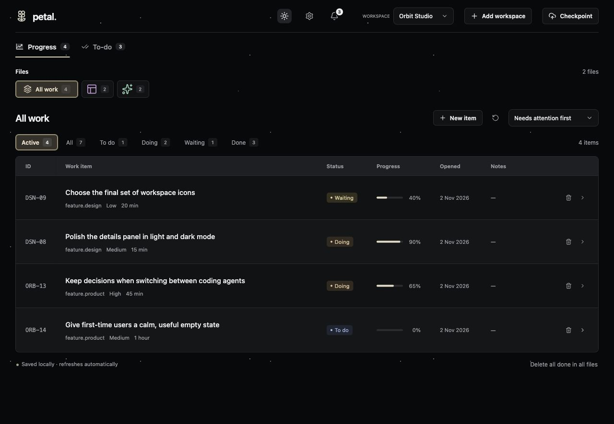

Warm cream by day. Black sky with subtle stars and animated shooting stars by night. Theme choice stays in this browser; reduced-motion preferences disable the shooting stars.

</details>

## Install globally

Requires **Node.js 22+**, npm, and Git. No model API key or Petal account is needed.

```sh
# 1. Get the public application source
git clone https://github.com/luckysolanki902/petal.git
cd petal

# 2. Install dependencies and build the app
npm ci
npm run build

# 3. Make the petal command available from any directory
npm link

# 4. Install skills for your local coding agents
petal setup
```

`npm link` connects the global command to this checkout. Keep the checkout in place. If `petal` is not found, check that npm’s global executable directory is on your shell’s `PATH`, then open a new terminal. To update this installation, pull the latest app source, run `npm ci && npm run build`, then run `petal setup` to refresh managed skills.

Prefer an installable package instead of a linked checkout? Build and pack it:

```sh
npm pack
npm install -g ./petal-workspace-0.1.0.tgz
petal setup
```

The package name is `petal-workspace`; it is **not published to the npm registry yet**. Use the source or local tarball instructions above. A global install installs the command for your OS user, not every account on the machine.

## Add a workspace

### From the dashboard

Run `petal`, choose **Add workspace**, and enter a name and the full path to an existing source project folder. On a fresh installation, use **Add your first workspace**.

The setup form lets you choose whether to install global agent skills and connect the project’s instruction files. It explains both before writing anything. Adding a workspace never pushes data.

### From your terminal

```sh
cd /path/to/your/project
petal init --name "My project"
petal doctor
petal
```

Or name a source folder directly:

```sh
petal init /path/to/another/project --name "Another project"
```

Repeat for each project. Workspaces have independent tasks, categories, statuses, and fields. Switch between them in the dashboard. `petal init` creates the tracker in `~/.config/petal/data/projects/`, registers its source root, and adds a small managed section to `AGENTS.md` and `CLAUDE.md` in that source root. Existing instructions and tasks are preserved. Use `--no-agent-files` to skip those instruction files.

Re-running `init` is safe: it reconnects missing instruction sections without replacing tracker data. Workspace IDs and source paths are local to your machine; the project instruction block contains portable commands instead of a hard-coded machine ID. Each developer registers their own checkout.

`petal` starts or reuses a background server at `http://localhost:8766` and opens the browser. It keeps running after the terminal command finishes; stop it with `petal stop`.

## How Claude Code and Codex find Petal

| Piece             | What it does                                                              | Scope                                         |
| ----------------- | ------------------------------------------------------------------------- | --------------------------------------------- |
| `petal setup`     | Installs the bundled `petal` skill                                        | Your OS user, across projects                 |
| `petal init`      | Connects `AGENTS.md` and `CLAUDE.md` to tracking                          | The selected source project                   |
| `petal task list` | Resolves the nearest registered source root and reads tasks/configuration | Current workspace                             |
| `petal doctor`    | Reports the current workspace and project instruction connection          | Current directory, or explicit `--project ID` |

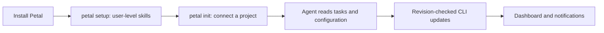

The installed skill tells the agent to use the matching workspace automatically for substantial project work. **If there is no matching workspace, it asks “Create a Petal workspace for this project? Yes / No”, naming the folder first.** Yes creates it; No continues your work without tracking there. Errors such as a missing CLI or broken registry are reported, never mistaken for permission to create a replacement. An explicit request to set up that project already counts as consent.

Restart existing agent sessions after setup. In Claude Code you can explicitly invoke `/petal`; in Codex ask it to use the Petal skill. Skills guide model behavior; they are not a background watcher or a guarantee that every model will invoke them. Project instructions reinforce the connection in future sessions.

These discovery locations follow the official documentation for [Codex skills](https://developers.openai.com/codex/skills), [Claude Code skills](https://code.claude.com/docs/en/skills), and [OpenCode skills](https://opencode.ai/docs/skills/):

| Agent       | Default user skill directory                                        |
| ----------- | ------------------------------------------------------------------- |
| Codex       | `~/.agents/skills/petal/`                                           |
| Claude Code | `~/.claude/skills/petal/` (`CLAUDE_CONFIG_DIR` is respected)        |
| OpenCode    | `~/.config/opencode/skills/petal/` (`XDG_CONFIG_HOME` is respected) |

Existing unmanaged skills are preserved. Setup does not create a workspace for the Petal app itself. Cloud-only chats do not gain local filesystem access through a skill install; use a local-capable agent or a separately configured local connection.

## Task tracking

### A board for the overview. A sidebar for the story.

Progress rows show the work, status, percentage, opened date, and notes preview. Collection chips and status filters include counts; **All work** brings collections together, and sorting helps surface what needs attention.

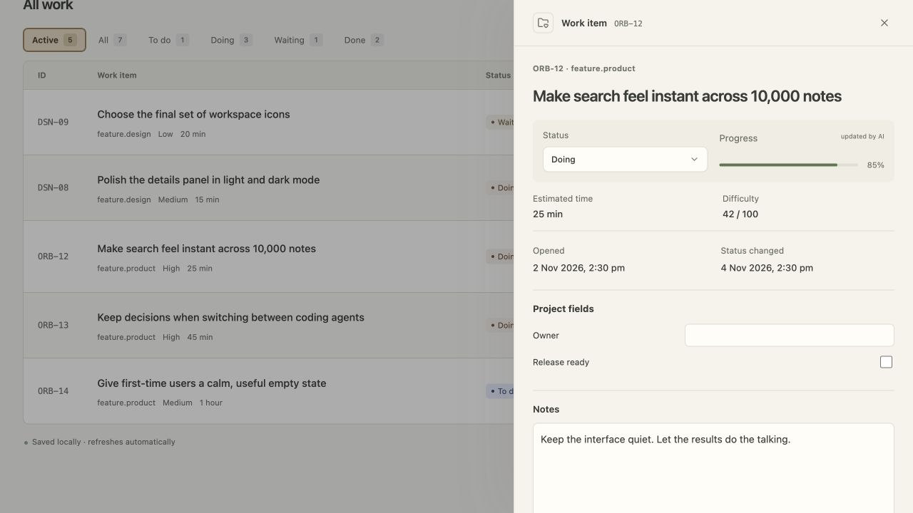

Open a row for the useful context: what the agent found, what changed, how it was checked, and what remains. Rich text renders Markdown, links, inline code, lists, tables, and checklists; structured and nested evidence can stay with the item instead of disappearing into chat history.

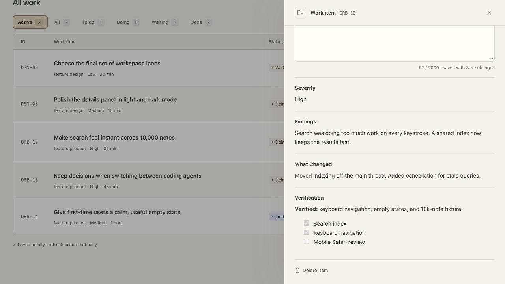

### Small to-dos deserve a good home too

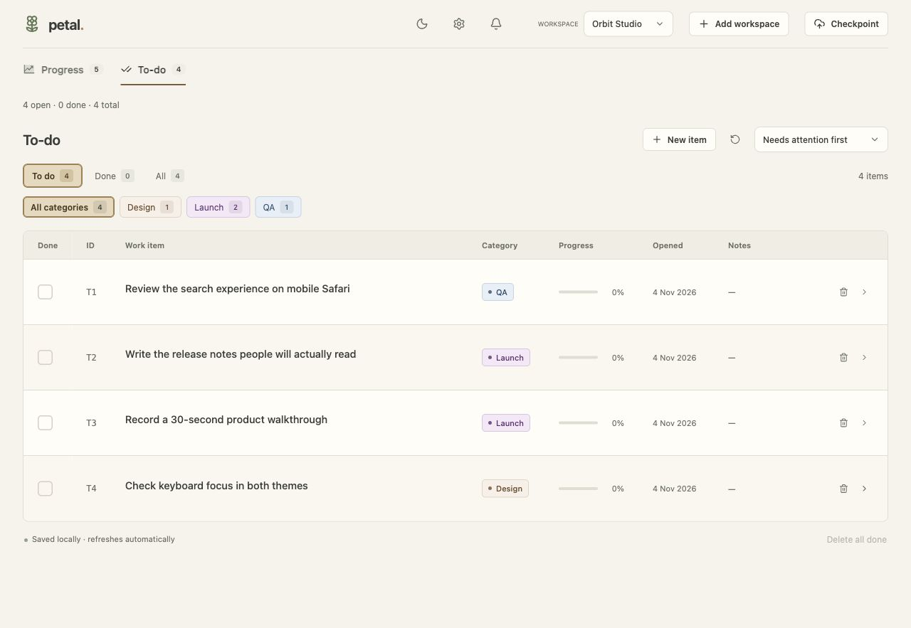

Quickly check an item off, filter by category, or open its sidebar to add a note. Category colors appear in filter chips, table badges, and item details. Tables show dates only; the sidebar adds the time without a timezone suffix.

### The rules behind the pretty bits

| Status  | Meaning                                                    |
| ------- | ---------------------------------------------------------- |
| To do   | Ready to start                                             |
| Doing   | Investigation, implementation, or verification is underway |
| Waiting | A decision or external dependency needs attention          |
| Done    | No required work remains                                   |

These are the defaults; projects can define their own workflow and completion rules in Settings.

Each item can also have an AI-maintained percentage, remaining-time estimate, and difficulty. An unassessed percentage displays a dash. Completion is an estimate of verified scope, not a timer. Configured completion statuses display 100%.

- Switch collections with icon chips; keep the overview across all work when that is more useful.
- Click a row to see findings, references, arbitrary nested evidence, timestamps, and notes.
- Check a to-do once to save immediately. No confirmation dialog.
- In the table, stage individual deletions with row undo, then review Save/Discard to persist. In the sidebar, Delete item opens an inline Yes/No confirmation; Yes immediately saves only that item’s deletion and keeps other drafts untouched.
- Bulk deletion includes hidden completed rows in the disclosed scope; it confirms before staging.
- Drafts survive reloads in the same browser session. Revision conflicts keep the draft and reject stale writes; review the latest evidence before discarding/reapplying it.
- Project switching is disabled while drafts are pending. Save or discard first.
- Checkpoint commits all registered project trackers to one shared Git repository. It stays local unless you connect an origin in Settings; with an origin, an explicit checkpoint also pushes. Disconnect the origin to return to local-only operation. No Git publication happens in the background.

## Notifications

### A little “hey, that’s ready” 🔔

Your agent changes a status through the CLI. Petal notices. A toast appears with the workspace, task, and a **View** button—so you can keep working until you are ready to look.

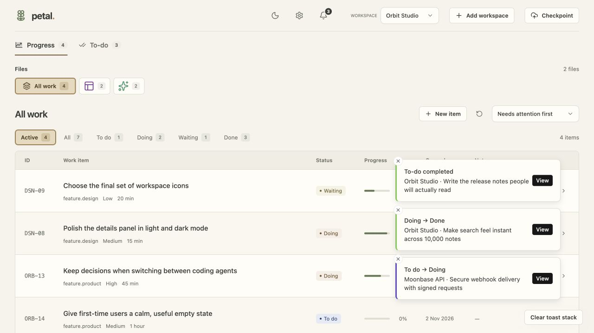

The bell is the place to catch up later. Start in the current workspace, switch to **All**, or check another workspace. Give each workspace its own sound so you can recognize which project needs you.

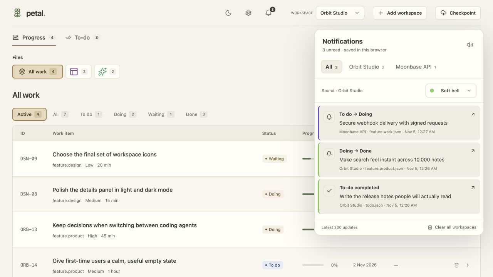

**Toast dismissed? The history stays.** Click an entry to travel to its workspace and collection, reveal the row, scroll it into view, and highlight it for five seconds.

### What gets saved, and where

The bell keeps the latest 200 observed status changes and to-do completion/reopening updates across workspaces. Its popover opens on the current workspace, with All and other workspace tabs. Each workspace gets an accent color and an automatically assigned sound; choose among six sounds in its tab or mute globally.

Sonner toasts stay until dismissed with their × or **Clear toast stack**. Dismissing a toast keeps its history in the bell. **Clear all workspaces** in the popover clears history for every workspace in this browser. History and sound choices persist locally in browser storage and synchronize between tabs on the same origin; they are not copied into tracker files or synced between browsers.

Click **View** or a history entry to open its workspace and collection, reveal the row regardless of saved filters, scroll to it, and highlight it for five seconds. Deleted items show an explanatory message. Existing drafts remain intact; switching workspaces uses the normal unsaved-changes protection.

Detection polls all registered workspaces every three seconds while Petal is open, including CLI/agent changes. The first observation establishes a baseline without generating old notifications. A failed workspace read preserves its previous baseline. Changes between polls can be coalesced into the latest observed state; this is not a complete server-side event audit. Sound starts after your first browser interaction, subject to browser autoplay rules.

## Project configuration in Settings

### Your workspace, your vocabulary

A release checklist, a research project, and a bug queue do not need identical workflows. Name the stages you use, choose their colors, and decide which stages count as complete.

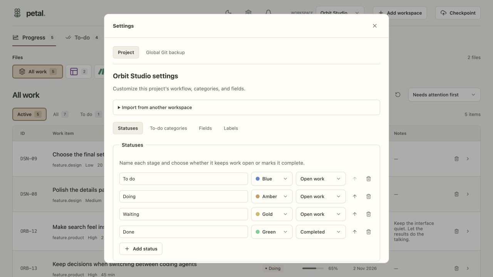

<details>
<summary><strong>Where do categories show up?</strong></summary>

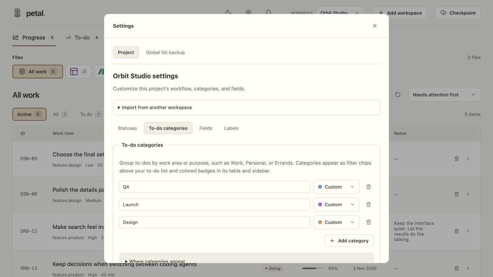

Categories group to-dos by purpose. Settings shows existing category names too, so a workspace with tasks does not start with an empty category editor.

</details>

Open **Settings → Project** to customize the selected project:

| Area          | Options                                                               |
| ------------- | --------------------------------------------------------------------- |
| Workflow      | Status names, order, colors, and which statuses complete work         |
| Categories    | Suggested category names and colors; existing names stay valid        |
| Custom fields | Optional text, number, and checkbox fields, editable in item details  |
| Labels        | Display names for findings, changes, verification, and status details |

Click **Review changes**, review the affected files, then **Apply changes**. Renaming or removing an existing status needs an explicit mapping. A stale preview cannot overwrite newer tracker changes. The app preserves IDs, evidence, creation dates, and status dates during label mappings, keeps a local migration audit, and journals multi-file writes so an interrupted application can roll back on the next operation. Changing a field type is rejected when existing values conflict; removing a definition preserves its saved values as extra evidence.

Configuration lives in `project-settings.json` beside the project's `data/` directory. The dashboard, CLI, save routes, counts, completion percentages, and bulk deletion share these rules. Agents receive the configuration from `petal task list`; they should use its exact status names and field types. Changing Settings never publishes data. To reuse a setup, choose **Import from another workspace**. It copies configuration into the editor only; it never copies tasks or changes the source workspace. Review and apply it separately. New workspaces have no preset categories, custom fields, or display-label overrides. To-do categories appear in list filters, table badges, and the item sidebar; they can be assigned when adding or editing a to-do. Settings automatically shows category names already used by the workspace, with matching colors, even before explicit definitions have been saved. [Configuration details](docs/project-customization.md).

## Stack logos and work icons

Petal bundles **500 Simple Icons brand logos + 402 Lucide work symbols**, including PostHog, GitHub, Docker, Next.js, servers, databases, testing, security, and bug variants. Assets load individually from the local app; no icon CDN is needed. Each collection gets a stable CSS tint, so files sharing the same logo remain visually distinct in both themes.

```sh
petal icons list --search posthog
petal icons list --search bug
petal icons set --project PROJECT_ID --file data/bug.analytics.json --icon brand-posthog
petal icons auto --project PROJECT_ID
```

`set` changes only the selected collection’s icon metadata; `auto` replaces all collection icon choices using filenames and task titles. Neither commits nor pushes. Existing explicit icon choices take precedence over automatic display inference. The installed skill explains how agents find and choose relevant icons. See [catalog, generation, and attribution](icons/README.md).

## Global Git backup

### Your work log has a history

Every workspace’s tracker lives in one separate local Git repository. A checkpoint gives you a commit to inspect later; connect your own remote when you want a backup.

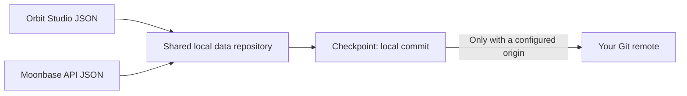

Open **Settings → Global Git backup**. Its origin and shared data directory apply to **every workspace on this machine**, while workflow settings remain per workspace.

1. Create an empty **private** Git repository with your Git provider.
2. Enter its SSH or HTTPS URL as the Git origin and save global settings.
3. Click **Checkpoint**, review its all-workspaces scope, and confirm.

Saving the origin never publishes by itself. A checkpoint validates trackers, commits local changes, and pushes when an origin is connected. Without an origin, checkpoints stay local. Your existing Git credentials handle authentication; do not put passwords in repository URLs. No background push, force-push, or automatic pull occurs. Push failures preserve the local commit and report the failure so you can resolve it and retry.

The data repository is separate from this public application repository. Never attach a private tracker-data origin to the app source repository or commit real task evidence into the app. Disconnect the data origin in global settings to return to local-only checkpoints.

## CLI

| Command                                                | Purpose                                                                      |
| ------------------------------------------------------ | ---------------------------------------------------------------------------- |
| `petal`                                                | Start/reuse the dashboard and open it                                        |
| `petal --no-open --port 9000`                          | Run locally on a chosen port without opening a browser                       |
| `petal setup`                                          | Install or refresh managed skills for all supported agents                   |
| `petal skills install --agent codex`                   | Install only the Codex skill (`claude`, `opencode`, or `all` also supported) |
| `petal init [PATH] --name "Project"`                   | Register a source project and connect project instructions                   |
| `petal init [PATH] --no-agent-files`                   | Register without editing project instruction files                           |
| `petal register PATH --data DIR --name "Project"`      | Import an existing valid tracker directory                                   |
| `petal icons list --search posthog`                    | Search bundled brand logos and work symbols                                  |
| `petal icons set --file FILE --icon ID [--project ID]` | Choose a collection icon without changing its tasks                          |
| `petal icons auto [--project ID]`                      | Reassign collection icons from filenames and task titles                     |
| `petal projects`                                       | List registered workspaces, IDs, and data locations as JSON                  |
| `petal doctor [--project ID]`                          | Check workspace and agent instruction wiring                                 |
| `petal status` / `petal stop`                          | Inspect or stop the verified local server                                    |
| `petal task list [--project ID]`                       | Read tasks, file revisions, and workspace configuration as JSON              |
| `petal --help`                                         | Show command help                                                            |

Task commands select the nearest registered source root from the working directory. Outside a registered project they fail safely; use an exact workspace ID from `petal projects` to select one explicitly. Dashboard launch can be global. A mistyped explicit project selector is an error.

### Add progress work or a to-do

```sh
cd /path/to/your/project
petal task add --title "Implement search" --file data/feature.work.json
petal task add --title "Review search behavior" --todo --category "Review"
petal task list
```

To work from any directory, add `--project PROJECT_ID`. Existing workspaces may use different progress filenames: use the paths returned by `task list`.

### Update an item without overwriting newer evidence

Read `petal task list --project PROJECT_ID`, then save a JSON patch containing only fields you want to change:

```json
{
  "status": "Doing",
  "progress": 60,
  "rootCause": "Implementation is ready; browser verification is still pending."
}
```

```sh
petal task update ITEM_ID --project PROJECT_ID \
  --file data/feature.work.json --input /path/to/patch.json \
  --revision REVISION_FROM_TASK_LIST
```

Use the workspace’s actual status names and custom field types from `configuration`, not assumptions from another project. IDs and creation dates are immutable. The CLI manages lifecycle timestamps. A stale revision rejects the update: reread and reconcile before retrying. Legacy tracker registration validates existing data and never silently rewrites it.

## A few honest answers

**Does Petal run Claude or Codex for me?** No. Petal stores and displays the work. The installed skill teaches a local-capable agent how to read and update it.

**Will installing the skill make agents always use it?** Skills guide model behavior. Project instructions reinforce the workflow, and you can explicitly ask the agent to use Petal. Restart existing sessions after installing or refreshing skills.

**Does anything leave my machine?** Petal makes no model calls and includes no product analytics. Tracker data stays local unless you explicitly checkpoint with a connected Git origin. Your coding agent has its own data-handling behavior.

**Can I use it without an agent?** Yes. Add items and to-dos, edit notes and custom fields, manage statuses, and use the dashboard yourself. Progress estimates and verification are intended to come from the working agent.

**Is this a hosted team service?** It is a local app for your OS user. Register each developer’s own checkout; a skill install does not give cloud-only chats access to local files.

**Where is the npm install command?** The package is not published to the registry yet. Clone and link it, or install a locally built tarball using the instructions above.

## Troubleshooting

| Symptom                    | What to check                                                                                                     |
| -------------------------- | ----------------------------------------------------------------------------------------------------------------- |
| Agent cannot find Petal    | Run `petal setup`, restart the agent, then run `petal doctor` from the source project                             |
| No matching workspace      | Run `petal projects`; initialize the correct source root or pass `--project ID`                                   |
| Instructions still missing | Re-run `petal init` in that source root; symlinked or malformed instruction blocks are reported for manual repair |
| Source checkout not built  | Run `npm ci` and `npm run build` in the Petal app checkout                                                        |
| Dashboard unavailable      | Run `petal status`; check the log at `~/.config/petal/server.log`; try an unused `--port`                         |
| Revision conflict          | Read the current item and merge your patch with the new evidence                                                  |
| Private Git push fails     | Check the data repository’s origin and your Git authentication; the local checkpoint is retained                  |

## Files & architecture

```text
petal/                       Application repository / installed package
  app/                       Next.js page and local API routes
  components/                React workspace and evidence rendering
  lib/                       Schema validation, file storage, project registry
  bin/                       Cross-platform Node CLI and server launcher
  skills/petal/              Portable agent instructions
  tests/                     Isolated, synthetic fixtures

~/.config/petal/             User-local registry, process state, and logs
  projects.json              Project names, source roots, and tracker locations
  data/                      One Git repository, no origin by default
    projects/PROJECT_ID/
      data/feature.work.json
      data/todo.json
      file-icons.json
```

Existing registrations are imported into the shared repository with byte-for-byte JSON verification. Stable project IDs are preserved. The original JSON files remain as backups, and a timestamped registry backup is saved before switching paths. Use the CLI and the registered `dataDir` thereafter; the old copies are not synchronized. All JSON below a registered tracker directory is imported, including audits and operations metadata; application source and Git history are excluded.

Settings shows the shared repository path and optional Git origin. Saving an origin does not contact the remote or publish anything; the next explicitly confirmed Checkpoint pushes. Authentication uses your existing Git SSH keys or credential manager. Push failures preserve the local commit and report its ID so the checkpoint can be retried. No force-push or automatic pull is performed.

Set `PETAL_HOME` to use a different registry/state/data directory. Project registration uses canonical absolute paths; move a project by registering its new location. Tracker rows are JSON arrays. Additional fields can contain arbitrary JSON, and are shown only in details. The schema and generated validator are bundled with the app.

The server binds only to `127.0.0.1`. Mutation requests require a local origin (when present) and a dedicated header. Writes use a shared on-disk lock, schema validation, revision checks, and atomic file replacement. A stale `.petal-write-lock` after a crash is reported explicitly; verify the recorded PID is gone before removing it. Project registry entries are trusted local configuration, not arbitrary paths supplied by browser requests.

The UI uses system fonts, with cream light mode and a black-sky dark mode with subtle stars and animated shooting stars (disabled when reduced motion is preferred). Toggle the theme in the header; your choice is saved in this browser. Notes are edited only in the details sidebar. No product analytics or AI calls are included.

## Development

```sh
npm run dev
npm run build:validator       # after editing tracker.schema.json
npm run typecheck
npm test
npm run build
```

Tests use temporary directories; never test deletion or publication on real project data. Keep meaningful store, CLI, and HTTP tests alongside changes. Verify the desktop and narrow layouts in a browser. Format only changed files with Prettier.

Before publishing, inspect `npm pack --dry-run` and the tarball for private data and machine-specific paths. A release should have green tests and build, a public repository, and an audited package. Packaging is supported; registry publication and a hosted service are not automatic.

## Contributing

Small, thoughtful improvements are welcome. Preserve local ownership, clear error messages, accessibility, and the distinction between estimated progress and verified completion. File an issue before a major schema or synchronization change. Do not include real project evidence, credentials, or private user paths in issues or fixtures.

## License

MIT. Provider logos in `icons/` identify integrations; their names and marks belong to their respective owners and do not imply endorsement.
